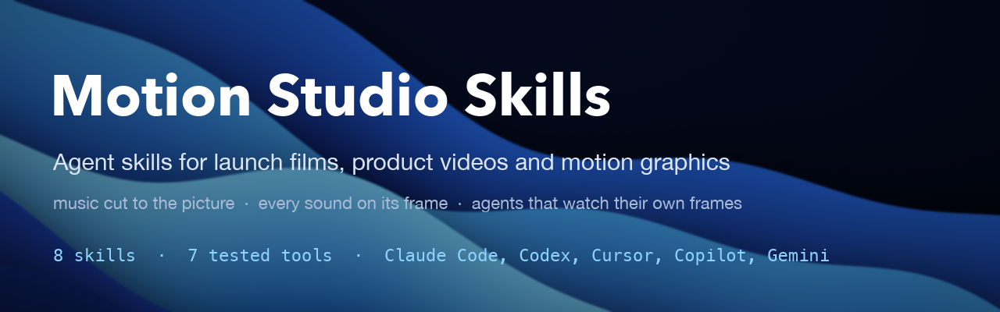
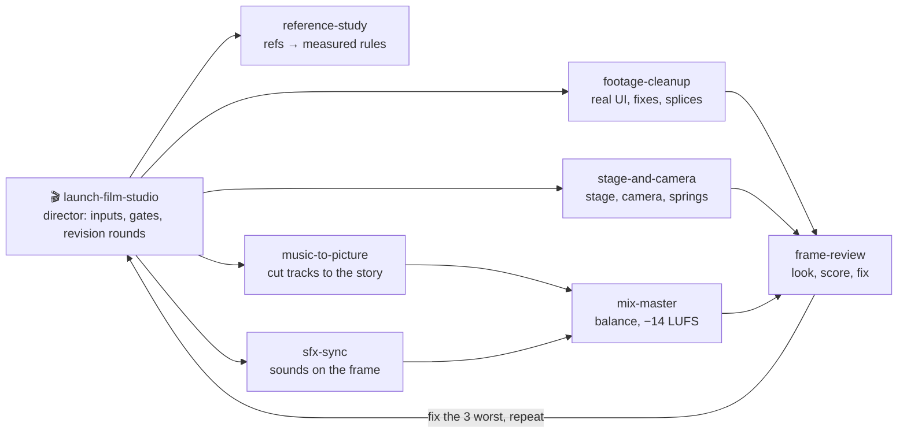
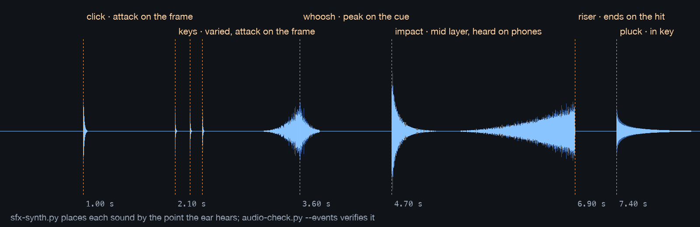
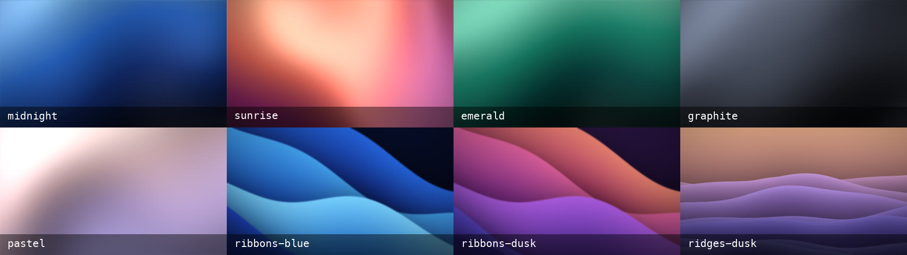

<p align="center">
  
</p>

<p align="center">
  <a href="https://github.com/Meraj-08/motion-studio-skills/actions/workflows/validate.yml"></a>
  <a href="https://github.com/Meraj-08/motion-studio-skills/releases/latest"></a>
  
  
  <a href="https://agentskills.io"></a>
  <a href="LICENSE"></a>
</p>

<p align="center">
  <b>Make AI-built launch films look and sound finished.</b><br>
  Real product screens in · music cut to the picture · every sound on its frame · an agent that watches its own frames
</p>

<p align="center">
  <a href="#install">Install</a> · <a href="#the-skills">Skills</a> · <a href="#how-it-works">How it works</a> ·
  <a href="#a-revision-round-as-it-happened">Example</a> · <a href="#the-tools">Tools</a> · <a href="#faq">FAQ</a> ·
  <a href="CHANGELOG.md">Changelog</a>
</p>

---

## Why this exists

Ask an agent for a launch video and you usually get the same film: centered text on a gradient, everything fading in,
a stock track playing straight through. **The prompt is 10 % of a good film. The other 90 % is the harness.**

These skills are that harness. They were built while making one 73.5-second launch film through **85 versions in 8
days**, and every rule answers a real review note: *"44 s hits too hard"*, *"the merge sound is late"*, *"the music is
monotonic"*, *"the intro is off-theme"*, *"the phone part needs to show it thinking"*. On top of the rules sit seven
small tools that measure the picture and the sound, so the agent works from numbers instead of guesses.

They direct your agent; the composition itself is built with a framework such as
[HyperFrames](https://github.com/heygen-com/hyperframes), [Remotion](https://www.remotion.dev) or a plain `seek(t)`
page.

## What's new

**v1.0.0 (2026-10-20)**: first release. 8 skills, 7 tested tools, evals for every skill, a validator and an
end-to-end smoke test in CI, installs for Claude Code, Codex, `gh skill`, `npx skills` and claude.ai.
[Full changelog](CHANGELOG.md)

## The skills



| Skill | Use it when you… | Ships |
|---|---|---|
| [**launch-film-studio**](skills/launch-film-studio/SKILL.md) | want a launch or product film from real screens, or have timestamped notes on one | brief templates, a 73.5 s case study, shipping checklist |
| [**reference-study**](skills/reference-study/SKILL.md) | share reference videos: *"make it like this"* | measured studies of 15+ launch films, the REFERENCE.md format, a toolkit |
| [**music-to-picture**](skills/music-to-picture/SKILL.md) | need a track fitted, swapped, slowed or re-cut to the picture | `beatgrid.py`, the story-point arrangement |
| [**sfx-sync**](skills/sfx-sync/SKILL.md) | need UI and motion sound effects on exact frames | `sfx-synth.py`, placement rules, DSP recipes |
| [**mix-master**](skills/mix-master/SKILL.md) | hear *"too loud at 44 s"* or need a social master | `master-mux.sh`, change-safe mixing |
| [**frame-review**](skills/frame-review/SKILL.md) | just rendered something and want it checked properly | `review-sheets.sh`, critique prompt, scoring |
| [**footage-cleanup**](skills/footage-cleanup/SKILL.md) | have glitches, a wrong status bar, joins between takes, soft text | splice finder, cleanup techniques |
| [**stage-and-camera**](skills/stage-and-camera/SKILL.md) | find the screen flat, want 3D, a background or vertical cuts | `wallpapers.py`, springs, shot grammar |

Each skill is self-contained (its scripts travel with it), so you can install one or all.

## Install

<details open>
<summary><b>Claude Code</b> (plugin)</summary>

```text
/plugin marketplace add Meraj-08/motion-studio-skills
/plugin install motion-studio@motion-studio-skills
```
</details>

<details open>
<summary><b>Any agent</b> with the GitHub CLI (<code>gh skill</code>, v2.90+)</summary>

```bash
gh skill install Meraj-08/motion-studio-skills                      # pick interactively
gh skill install Meraj-08/motion-studio-skills --all --agent claude-code
gh skill install Meraj-08/motion-studio-skills sfx-sync --agent cursor   # one skill
gh skill install Meraj-08/motion-studio-skills --all --agent codex --pin v1.0.0
```
Works for Claude Code, Codex, Cursor, GitHub Copilot, Gemini CLI, OpenCode, Goose and 40+ more agents
(`gh skill install --help` lists them). Preview first with `gh skill preview Meraj-08/motion-studio-skills <skill>`.
</details>

<details>
<summary><b>Any agent</b> with the skills CLI (<code>npx skills</code>)</summary>

```bash
npx skills add Meraj-08/motion-studio-skills
npx skills add Meraj-08/motion-studio-skills --skill music-to-picture sfx-sync
```
</details>

<details>
<summary><b>OpenAI Codex</b> (plugin)</summary>

```bash
codex plugin marketplace add Meraj-08/motion-studio-skills
# then inside Codex: /plugins → motion-studio
```
</details>

<details>
<summary><b>claude.ai and Claude Desktop</b></summary>

Download a skill's `.zip` from [Releases](https://github.com/Meraj-08/motion-studio-skills/releases/latest), then
**Customize → Skills → + Create skill → Upload a skill**. One skill per archive; code execution must be enabled.
</details>

<details>
<summary><b>Manual</b>, git submodule</summary>

```bash
git clone https://github.com/Meraj-08/motion-studio-skills
cp -R motion-studio-skills/skills/* ~/.claude/skills/          # or your agent's skills folder
# or keep it updatable inside a project:
git submodule add https://github.com/Meraj-08/motion-studio-skills .skills/motion-studio
```
</details>

**Requirements for the tools**: `ffmpeg` + `ffprobe`, Python 3 with numpy (`pip install -r requirements.txt`; scipy
only for backgrounds), and `rubberband` if you change a track's tempo. No API keys, no network access.

## How it works

1. **Measure the picture.** Events come from the rendered video (`picture-events.py`, frame strips), never from a
   brief's timecodes. One table, `docs/EVENTS.md`, drives music, effects and titles.
2. **Cut real music to the story.** A licensed track, measured (`beatgrid.py`) and cut on its own downbeats: the drop
   on the first real action, suspense on a failure, the biggest return on success, its own ending on the end card.
3. **One audible sound per event**, placed by the point the ear hears: clicks on the frame, whooshes peaking
   100–250 ms before the cut, risers ending on the hit (`sfx-synth.py`, `audio-check.py --events`).
4. **Look at your own frames.** Contact sheets, phone-size sheets, frame strips; score; fix the three worst; repeat
   until every score is 8+ (`review-sheets.sh`).
5. **One change per version.** Prove nothing else moved (`audio-check.py --vs`), and report it in the reviewer's words.

The director skill runs this as a pipeline with approval gates (shot list → stills → picture → sound → review →
delivery) and handles the part that takes most of the time: revision rounds.

## A revision round, as it happened

From the film these skills came from. The note was the kind every round started with:

> *"The merge sound feels a little late."*

**1 · Find the frame, and check it by eye** (`frame-review`). The log said the PR badge flips to *Merged* at
42.867 s. A strip of consecutive frames showed it flips at **frame 2570 = 42.833 s**: two frames earlier.

```bash
review-sheets.sh film.mp4 review/v85 --strip 42.78
picture-events.py film.mp4 --from 42.5 --to 43.2 --region 640,450,220,100
#   42.833 s  frame  2570  diff 15.6  ← starts
```

**2 · Measure the sound against it** (`sfx-sync`).

```text
audio-check.py stem-sfx.wav --events 12.9:send,42.833:merged
  send     frame 12.900 · peak 12.902 (Δ  +2 ms)     on its frame
  merged   frame 42.833 · peak 42.880 (Δ +47 ms)     ~3 frames late (a layered hit: align its peak)
```

**3 · Change only that, and prove it** (`mix-master`): move the merge group −47 ms with the mixer's opt-in switch,
re-master, and confirm with `audio-check.py new.wav --vs approved.wav` that nothing outside 42–44 s moved.

Earlier rounds on the same film ran the same way: *"Merged −10 dB"* moved the moment only 0.5 dB when applied to the
named sound alone, because a low impact layer under it set the peak, so the whole hit group came down; *"lower the
background"* moved the master only 0.2–0.8 dB because of loudness normalization, so both numbers were reported. The full log is in the
[case study](skills/launch-film-studio/references/case-study.md).

## The tools

All seven run end to end in CI on media they generate themselves ([`scripts/smoke_test.py`](scripts/smoke_test.py)).

| Tool | What it measures or makes |
|---|---|
| `beatgrid.py` | tempo pinned by a full-track fold (150.00 / 120.00 / 110.00 on real tracks), sample-accurate beat phase, bar loudness, section changes, where the music ends |
| `picture-events.py` | hard cuts, motion per second, dead seconds, the exact frame a UI element changes, frames where two versions agree (invisible splices) |
| `audio-check.py` | LUFS and true peak, dynamics spread, per-section before/after, effect attack and peak vs the frame, audibility on small speakers, duck depth |
| `review-sheets.sh` | contact sheet labelled with film time, phone-size sheet, 12-frame strips, exact stills, loop check |
| `master-mux.sh` | two-pass −14 LUFS / −1 dBTP master muxed with the picture copied, a small review copy, a light sharpen |
| `sfx-synth.py` | clicks, varied key thocks, taps, sends, plucks in key, impacts heard on laptops, whooshes peaking on the cue, risers ending on it |
| `wallpapers.py` | original silk, ribbon and ridge backgrounds in any colours, so a stage never needs a licence |

<p align="center"></p>

```text
$ audio-check.py fx.wav --events 1.0:click,2.1:key,3.6:whoosh:0.7,4.7:impact,6.9:riser:0.3
  click    frame 1.000 · attack 1.000 (Δ  +0 ms) · peak 1.002 (Δ  +2 ms) · 400–4k 98 %
  key      frame 2.100 · attack 2.100 (Δ  +0 ms) · peak 2.103 (Δ  +2 ms) · 400–4k 52 %
  whoosh   frame 3.600 · attack 3.255 (Δ −345 ms) · peak 3.603 (Δ  +2 ms) · 400–4k 80 %
  impact   frame 4.700 · attack 4.700 (Δ  +0 ms) · peak 4.707 (Δ  +7 ms) · 400–4k 53 %
  riser    frame 6.900 · attack 6.885 (Δ −15 ms) · peak 6.888 (Δ −13 ms) · 400–4k 93 %
```

<p align="center"></p>

## What the reference films taught

Measured on Figma, Notion, agentplay, Procreate Dreams, Solimar, Paper Mono, OpenCode 2, Watchtower, Cursor, One and
more ([full studies](skills/reference-study/references/reference-films.md)):

- **The first frame is the idea, not a logo.** Every transition has a cause on screen: a click, a gesture, or an object
  crossing the cut.
- **Clicks land on the frame; whooshes peak 100–250 ms before the cut; arrivals land on the settle.**
- **Silence is punctuation**: a breath before each reveal, silence on the final logo.
- **"Monotonic" music** comes from repeated bars and no chord changes, not from a flat volume.

## FAQ

<details><summary><b>Does this generate the video?</b></summary>
No. The skills direct your agent (story, gates, timing, sound, review), and the tools measure and generate audio and
backgrounds. The picture is built with a composition framework (HyperFrames, Remotion, a <code>seek(t)</code> page) and
your real product recordings.
</details>

<details><summary><b>Do I need API keys?</b></summary>
No. Everything runs locally with ffmpeg and Python. If you choose to use a paid generator (music, voice), the skills
tell the agent to check your remaining credits first and to keep keys in <code>.env</code>.
</details>

<details><summary><b>The master didn't reach −14 LUFS.</b></summary>
A spiky mix can't get louder without breaking the −1 dBTP ceiling; <code>master-mux.sh</code> says so when it happens.
Compress or limit the mix, or accept the quieter master.
</details>

<details><summary><b>The downbeat is one beat off.</b></summary>
Tempo and beat phase are measured; the bar start is an estimate. Mark one bar start by ear and pass
<code>beatgrid.py track.mp3 --downbeat 1.914</code>.
</details>

<details><summary><b>"I can't hear anything."</b></summary>
Check the playback device first (Bluetooth earbuds are the usual culprit) before changing the mix.
</details>

<details><summary><b>Can I use music or footage from the reference films?</b></summary>
No. The studies take technique only. Use licensed music (and its credit line) and your own product footage.
</details>

<details><summary><b>A skill doesn't trigger.</b></summary>
Name it: <i>"use music-to-picture to fit this track"</i>. Each skill's description lists the phrases it responds to,
and <code>evals/evals.json</code> shows prompts it should and shouldn't pick up.
</details>

## Project layout

```text
skills/<name>/SKILL.md         the skill (frontmatter + workflow + rules)
skills/<name>/references/      detail it loads only when needed
skills/<name>/scripts/         its tools (copies; edit them in shared/scripts)
skills/<name>/evals/           prompts it should and shouldn't handle, with assertions
shared/scripts/                the seven tools · shared/manifest.txt says which skill ships which
scripts/                       validate_skills.py · smoke_test.py · sync_shared.py · package_skills.py
.claude-plugin/ .codex-plugin/ .agents/plugins/   install manifests
```

## Contributing

New skills, sharper measurements and more reference studies are welcome. Read [CONTRIBUTING.md](CONTRIBUTING.md),
then run `python3 scripts/validate_skills.py` and `python3 scripts/smoke_test.py`. Please follow the
[Code of Conduct](CODE_OF_CONDUCT.md); report security issues as described in [SECURITY.md](SECURITY.md).

## Credits and sources

The working method builds on public work by
[Movez](https://x.com/0xMovez/status/2104216919033192746) (the motion-studio course and the
[10-tool list](https://x.com/0xMovez/status/2111841847408517282)),
[beamnxw](https://x.com/beamnxw/status/2108616740846420354) (frame-numbered motion engineering),
[Lukas Margerie](https://www.youtube.com/watch?v=747ZnEtsRbg), [whatships.com](https://whatships.com) and
[Ordinary Folk](https://www.ordinaryfolk.co). Skill format: [Agent Skills](https://agentskills.io) and
[Anthropic's skills](https://github.com/anthropics/skills). Reference films are analysed for technique only; no
footage or music from them is included. All images in this README are generated by the repo's own tools.

## Star history

<a href="https://star-history.com/#Meraj-08/motion-studio-skills&Date">
  
</a>

## License

[MIT](LICENSE) © 2026 Md Meraj Alam
